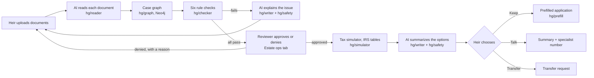

# HeritageGuard

> **Concept prototype. Not affiliated with Charles Schwab. All data is hypothetical.**
> Every person, account, balance and document in this repo is synthetic. Any number not
> taken from a cited source is a named config value labeled `hypothetical`
> (see [Hypothetical values](#hypothetical-values)).

HeritageGuard is a concept prototype for the UT Dallas JSOM "AI in Finance" case competition.
It helps an heir of a deceased brokerage client go from uploading documents to a prefilled
inherited-account application. The app the heir sees is called **Heir Guard**. An
"Under the hood" panel shows every AI step and check, and stands in for the reviewer's view.

## How it works

AI does exactly two jobs: **reading documents** and **writing plain English**. Numbers,
rules, routing and approval are deterministic code or a person.



The flow is a LangGraph state machine (`backend/hg/flow/graph.py`) with three pauses (waiting
for the heir's fix, for approval, for the heir's choice). Every transition is a plain Python
function over the check results; no LLM decides a route. Every step writes an audit entry.

### The two AI steps and where their checks live

| AI step | Code | What keeps it honest |
|---|---|---|
| Reading documents | `backend/hg/reader/` | Fixed field vocabulary and JSON schema; values the model can't read come back empty with low confidence and are flagged for review; the file name is never sent. Accuracy is measured against the synthetic truth files: `python -m hg.reader.evaluate` writes `ai_log/extraction_accuracy.md`. Planted errors (misspellings, wrong dates, photocopies) must be read as printed, so the rule checks catch them. |
| Writing plain English | `backend/hg/writer/` | The model sees only structured results, never documents. Every text passes `backend/hg/safety/check.py`: no number the calculator didn't produce, no advice phrases, no telling the heir which option to take. A blocked text is regenerated once, then replaced by a fixed template. Blocks are shown in the Safety tab. |

Every model call goes through `backend/hg/llm.py`, which masks SSNs and logs the prompt, input
summary, output and model to `ai_log/*.jsonl`. `python -m hg.ai_log_summary` writes
[ai_log/summary.md](ai_log/summary.md): call counts, extraction accuracy, a hand-checked RMD
from IRS Pub. 590-B, and three safety-check blocks.

## Repo layout

| Path | What |
|---|---|
| `backend/hg/schemas.py` | Shared Pydantic v2 contracts (money is always `Decimal`) |
| `backend/hg/config.py` | Env settings and named hypothetical defaults |
| `backend/hg/llm.py` | The only Anthropic client: SSN masking + JSONL call log |
| `backend/hg/store.py` | Supabase (Postgres + Storage) and Neo4j wrappers |
| `backend/hg/data_gen/` | Synthetic estate packet generator (M1) |
| `backend/hg/reader/` | AI document reader and its evaluation (M2) |
| `backend/hg/checker/`, `backend/hg/graph/` | Rule checks and the Neo4j case graph (M3) |
| `backend/hg/simulator/` | RMD and tax simulator; IRS tables with their source lines (M4) |
| `backend/hg/writer/`, `backend/hg/safety/` | AI writer and the safety check (M5, M6) |
| `backend/hg/prefill/` | Prefilled application traced to its documents (M7) |
| `backend/hg/flow/`, `backend/hg/audit.py`, `backend/api/` | LangGraph flow, audit trail, FastAPI (M8) |
| `web/` | React + TypeScript + Vite + MUI frontend (M9) |
| `supabase/migrations/` | SQL for tables and the private `packets` bucket |
| `data/packets/` | Generated synthetic estate packets (11 cases) |
| `ai_log/` | Raw LLM call logs (`*.jsonl`, git-ignored) and committed summaries (`*.md`) |

## Setup

Prerequisites: Python 3.11+, Node 20+, Docker. Nothing is installed globally.

```bash
cp .env.example .env   # then fill in values (never commit .env)
```

Supabase (Postgres, Storage, the LangGraph checkpointer) stays hosted. Run
`supabase/migrations/001_init.sql` in the Supabase SQL editor once. Without Supabase settings
the backend still runs: cases are kept in memory and uploads go to `data/uploads/`.

### Run the whole stack with Docker

```bash
docker compose up --build
```

- Web: http://localhost:5173
- API: http://localhost:8000 (health check at `/health`, docs at `/docs`)
- Neo4j browser: http://localhost:7474

### Host-side backend work (tests, scripts)

```bash
cd backend
python3 -m venv .venv
source .venv/bin/activate        # Windows: .venv\Scripts\activate
pip install -e ".[dev]"
pytest
```

Tests mock the Anthropic client and never call the API. The Neo4j tests run when a Neo4j is
reachable (`docker compose up neo4j`) and skip otherwise; CI always runs them against a
service container.

### Host-side web work

```bash
cd web
npm install
npm run dev     # Vite on 5173
npm test        # Vitest
npm run e2e     # Playwright demo path; needs the backend and web running (uses the real model)
```

## Running the demo

1. Open the web app. With no case chosen, the page starts at **Upload your documents**:
   dropping a packet's PDFs (from `data/packets/<id>/`) opens a case and finds the account on
   file from the death certificate.
2. Or pick a case from the **Case** menu. Each of the 11 synthetic packets has a neutral name;
   `packet_01_fixed` is the clean demo case and `packet_01_flawed` has a share error.
3. Open **Under the hood**: Extraction, Rules, Case graph, Simulator, Safety, Audit, and
   Estate ops, where the reviewer approves or denies the case with a reason.
4. After approval, enter an income and compare the four withdrawal options, then choose Keep,
   Talk to a professional, or Transfer out. All three stay available.

## Environment variables

See [.env.example](.env.example). Never commit values.

| Variable | Used by | Notes |
|---|---|---|
| `ANTHROPIC_API_KEY` | backend | |
| `ANTHROPIC_MODEL` | backend | `claude-sonnet-5-5` |
| `SUPABASE_URL` | backend | Project URL only, e.g. `https://<ref>.supabase.co` |
| `SUPABASE_SERVICE_KEY` | backend | The `sb_secret_` key; never in the web app |
| `DATABASE_URL` | backend | Supabase **session pooler** connection string (LangGraph checkpoints) |
| `NEO4J_URI`, `NEO4J_USER`, `NEO4J_PASSWORD` | backend | Local: `bolt://localhost:7687`, `neo4j`, `change-me-local-only` |
| `WEB_ORIGIN` | backend | The one origin allowed by CORS, e.g. `http://localhost:5173` |
| `VITE_API_URL` | web | The backend URL, no trailing slash; built into the page |

The browser never talks to Supabase or Neo4j directly; only the backend holds keys. An empty
line such as `NEO4J_URI=` overrides the default, so leave out what you don't set.

## Deploy

| Piece | Where | Settings |
|---|---|---|
| Neo4j | Neo4j AuraDB Free | Create an instance; keep its URI (`neo4j+s://...`), user and password |
| Backend | Render, Web Service, runtime Docker | Branch `main`; Dockerfile path `backend/Dockerfile`; Docker build context `.` (the repo root, so the sample packets are in the image); health check `/health`; all backend variables above, with `NEO4J_*` from AuraDB and `WEB_ORIGIN` set to the Vercel URL |
| Web | Vercel | Root directory `web`; framework Vite; `VITE_API_URL` set to the Render URL |

Check the backend at `<render URL>/health`: it should report `"checkpointer": "postgres"`.
Render's free tier sleeps when idle (the first request takes about a minute), only the Vercel
production URL matches `WEB_ORIGIN`, and changing `VITE_API_URL` needs a Vercel redeploy.

## Hypothetical values

| Name | Value | Where |
|---|---|---|
| `CONFIDENCE_THRESHOLD` | 0.85 | `backend/hg/config.py` |
| `DEFAULT_GROWTH_RATE` | 0.05 | `backend/hg/config.py` |
| `NAME_MATCH_THRESHOLD` | 90 | `backend/hg/config.py` |
| `UNPARSED_CONFIDENCE` | 0.5 | `backend/hg/reader/read.py` |
| `SPECIALIST_PHONE`, `SPECIALIST_HOURS` | (800) 555-0142, weekday hours | `web/src/config.ts` (555-01xx is reserved for fiction) |
| Account balances | varies | synthetic packets, labeled in the schema and the UI |

IRS figures are not hypothetical: the life expectancy table and tax brackets are parsed from
IRS Pub. 590-B and Rev. Proc. 2025-32, with the source line as the first line of each CSV
(`backend/hg/simulator/tables/`).

## Known limits

- The documents are clean, machine-generated PDFs, so the measured extraction accuracy is a
  best case. Scans, phone photos and handwriting are untested.
- A certified copy can't be proven from an upload; the reader only reports visible signs of a
  copy. The reviewer still checks the original.
- The simulator covers the 10-year rule path for designated beneficiaries. Spouses and
  eligible designated beneficiaries see the 10-year path for comparison; pre-2020 deaths and
  estate or trust beneficiaries are flagged for a specialist with no scenarios.
- Federal tax uses this year's brackets for every future year, ignores other deductions and
  credits, and state tax is a flat rate the heir enters.
- Uploads without a case are matched to the account on file only when the death
  certificate's name and date of death match one of the synthetic records.
- The prefilled application is a proposed handoff, not a submission. The specialist phone
  number and hours are placeholders.

## LLM wrapper notes

`claude-sonnet-5-5` rejects forced tool use, so `extract_json` gets guaranteed-valid JSON
through structured outputs (`output_config.format` with a JSON schema). Requests opt into
the API's server-side refusal fallback; a refusal that still comes back raises
`LLMRefusalError` and is logged.
